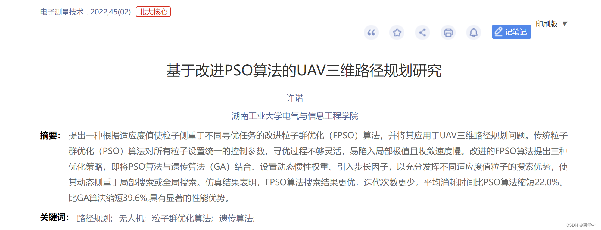
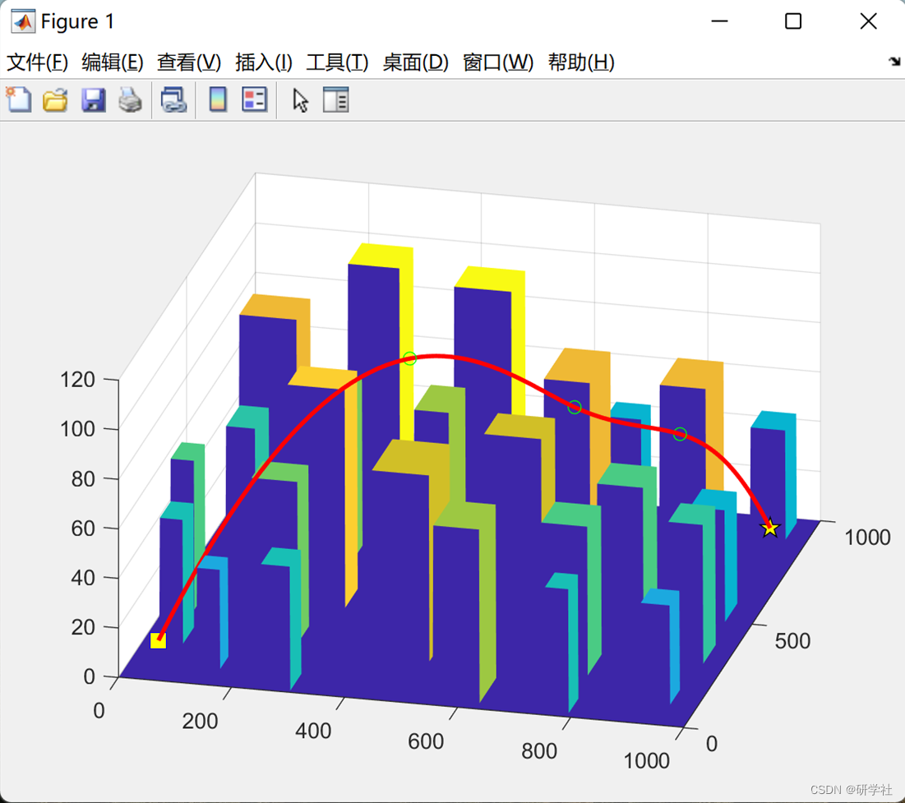

# Research on UAV Three-Dimensional Path Planning Based on Improved Particle Swarm Optimization Algorithm (Matlab Code Implementation)

💥💥💞💞 Welcome to this blog❤️❤️💥💥
🏆 Bloggers' Advantages: 🌞🌞🌞 The content of the blog strives for rigorous thinking and clear logic to facilitate readers.
⛳️ Mantra: "A journey of a thousand miles is begun with a single step." Directory 💥1 Overview📚2 Run Results🎉3 References🌈4 MATLAB Code Implementation
💥1 Overview  The path planning requirement requires intelligent agents to quickly find the optimal path composed of multiple path points smoothly connected in the planning space, based on optimization objectives and constraints! 1. Theoretical research on path planning has been widely applied in fields such as mining, rescue, aerospace, agricultural inspection, etc. The integration of path planning research with unmanned aerial vehicle technology has gradually led to the development of intelligent UAVs. 21. Efficient and reliable path planning algorithms are crucial for UAVs to complete tasks in complex and dangerous environments.
In recent years, particle swarm optimization (PSO) algorithms, representative of the swarm intelligence optimization, have attracted attention from domestic and international scholars and have developed rapidly. Domestic researchers such as Wu Xi et al. proposed a three-dimensional trajectory planning algorithm based on adaptive Cauchy mutation in PSO, which leverages exponentially weighted inertia and Cauchy mutation step length adjustment strategies to force particles to escape local extremities and accelerate convergence; Wang Yihu et al. introduced bacterial foraging optimization (BFO) chemotaxis and migration operations into the PSO algorithm, effectively improving some shortcomings of the PSO algorithm and enhancing its search capability; Fu Xingwu et al. [6] proposed an improved PSO algorithm that combines the beetle antennae search (BAS), using individual beetles' judgment of the environmental space in each iteration to make paths more reasonable and search more efficient; Yang Chaojie et al. proposed a new adaptive updating strategy for three control parameters in the algorithm, and utilized an adaptive logistic chaotic mapping to optimize global optimal particles, guiding the population out of local extremity points; Chen Tianpei et al. [8] introduced the pheromone in ant colony optimization (ACO) to speed up convergence, and used fuzzy processing to control the input quantity of path planning to prevent the system from falling into local optima; Chen Qiulian et al. adopted neural network unified obstacle environment modeling to achieve rapid collision detection with obstacles, while planning smooth paths without collisions, improving the algorithm's convergence speed. In foreign countries, Samigulina et al. [10] proposed an improved inertia weight collaborative PSO algorithm (CPSOIN), which integrates the advantages of the inertia weight PSO (IWPSO) algorithm and the collaborative PSO (CPSO) algorithm, has certain advantages in intelligent prediction and control of complex objects; Jakubik et al. drew on the concept of Bayesian optimization, fitted the random substitution model of the objective function using Gaussian processes, and adjusted particle motion according to the model. Experiments show that this improvement significantly enhances the performance of the algorithm.
References:  
Editor  
📚2 Run results editor  
🎉3 Reference [1] Xu Nao. Research on UAV Three-Dimensional Path Planning Based on Improved PSO Algorithm [J]. Electronic Measurement Technology, 2022, 45(02):78-83. DOI:10.19651/j.cnki.emt.2108102.  
🌈4 MATLAB code implementation

## Images

<!-- PAYMENT_BLOCK -->

## Get this dataset

- Payment link (Stripe): [Buy now](https://buy.stripe.com/3cs8yP7sY87d0vu9AB)
- Payment QR code: 

<!-- /PAYMENT_BLOCK -->
